# XiaoBao-Pygame | Python Game Series Curriculum (Teacher & Educator Edition)

[](https://opensource.org/licenses/MIT)
[-blue.svg)](https://www.python.org/)
[](https://github.com/HenryYannis/xiaobao-pygame/actions/workflows/ci.yml)
[](https://www.pygame.org/)
[](#curriculum-syllabus-difficulty-ladder)

This repository is designed specifically for **programming beginners** and **K-12 educators**. It contains an educational curriculum based on the **Pygame** engine. The curriculum includes **18 classic games** of varying difficulty levels, split across **69 step-by-step, progressive lessons**. It is designed to teach students logical thinking and coordinate-based math concepts through interactive, playful examples.

---

## 🎨 Pedagogical Coding Rules (The 5 Core Laws)

To ensure that the code is completely beginner-friendly and readable, all files in this repository strictly adhere to the following **five core laws**:

1. **Pure Chinese Identifier Naming**: All variable and function names are written directly in Chinese characters (natively supported by Python 3 UTF-8). This eliminates English vocabulary barriers for young learners and makes reading code feel as natural as reading a sentence.
2. **Column-Aligned Inline Comments**:
   - Comments are placed at the end of code lines and vertically aligned around column 50–55 using spaces. The left side is clean code, and the right side is orderly explanation.
   - Boilerplate lines (imports, `pygame.init()`, simple zero-assignments) are left unencumbered. Comments strictly focus on coordinates, key math, collision algorithms, and Pygame mechanics.
3. **Lesson Balance (3–5 Lessons, No Rigid Line Limit)**: No artificial line count limits. Priority is placed on clean, self-explanatory logic rather than compressing multiple statements. Each game is built within **3 to 5 lessons** so students experience the satisfaction of completing a game in a digestible timeframe.
4. **Zero External Assets & Default Font (Error-Proof & Universal)**:
   - All visual rendering is done using Pygame vector drawing methods (`pygame.draw.circle`, `pygame.draw.rect`, etc.). No external images or audio files are used, preventing file-path errors.
   - Strictly uses Pygame's built-in default font `pygame.font.Font(None, 36)`. Never loads system fonts to guarantee cross-platform compatibility. All on-screen rendered text uses clean English (e.g., `SCORE`, `GAME OVER`, `YOU WIN!`, `TIME UP!`).
5. **Incremental Diff Markers**: Newly introduced lines compared to the previous lesson are marked at the end of the line: `# 新增变量：` (new variable), `# 新增函数：` (new function), or `# 新增代码：` (new code); lines rewritten from the previous lesson use `# 修改代码：` (changed code). Run `python tools/check_increment.py` to check the markers.

---

## 🧭 Curriculum Syllabus (Difficulty Ladder)

The syllabus scales gradually from single click event checks to complex multi-body collision detection, finite state machines (FSM), and polar coordinate mechanics:

| Difficulty | Index | Game Title | Lessons | Core Pedagogical Concepts | Preview |
| :--- | :---: | :--- | :---: | :--- | :---: |
| **Beginner** | 01 | [Pixel Painter](./01-像素画家/) | 3 Lessons | 2D coordinate grid creation, cursor-to-cell index math, palette switching | 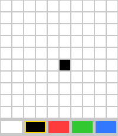 |
| **Beginner** | 02 | [Click & Pop](./02-点击消除/) | 3 Lessons | Click coordinate checks, random positioning, Euclidean distance detection | 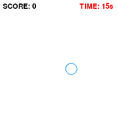 |
| **Beginner** | 03 | [Beat Block](./03-节奏方块/) | 4 Lessons | Rhythmic hit line window checks, 3-track random blocks, combo score multiplier | 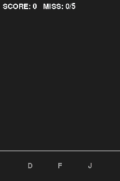 |
| **Beginner** | 04 | [Catch the Fruits](./04-接水果/) | 5 Lessons | Horizontal basket movement, multi-fruit descending list, miss detection | 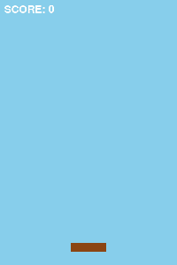 |
| **Beginner** | 05 | [Whack-A-Mole](./05-打地鼠/) | 3 Lessons | 3x3 grid coordinate mapping, timer popups, hammer hit logic | 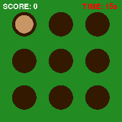 |
| 🟩 **Elementary** | 06 | [Paddle Ball](./06-弹跳球接球/) | 3 Lessons | Gravity freefall, paddle controls, elastic rebounds from walls and paddle | 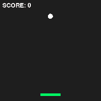 |
| 🟩 **Elementary** | 07 | [Dino Runner](./07-小恐龙跳一跳/) | 3 Lessons | Ground baseline, gravity jump physics, cactus scrolling & colliderect | 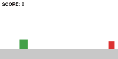 |
| 🟩 **Elementary** | 08 | [Tic-Tac-Toe](./08-井字棋对战/) | 3 Lessons | 3x3 grid lines, 1D board array model, 8 winning lines & tie detection | 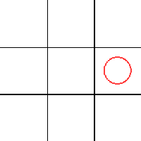 |
| 🟩 **Elementary** | 09 | [Slider Puzzle](./09-数字拼图/) | 3 Lessons | 100% solvable shuffle, Manhattan distance neighbor sliding, win verification | 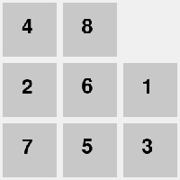 |
| 🟦 **Intermediate**| 10 | [Snake](./10-贪吃蛇/) | 5 Lessons | Discrete grid movement, turning anti-reversal, head-insert & tail-pop, self-bite check | 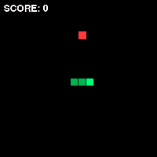 |
| 🟦 **Intermediate**| 11 | [Flappy Bird](./11-横版飞行避障/) | 3 Lessons | Flappy jump velocity, paired green pipes scrolling, survival gap passage | 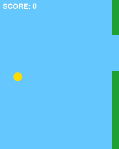 |
| 🟦 **Intermediate**| 12 | [Fruit Slasher](./12-水果切切乐/) | 3 Lessons | Parabolic projectile motion, mouse dragging trace line, slicing detection | 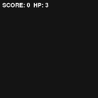 |
| 🟦 **Intermediate**| 13 | [Color Matcher](./13-颜色匹配/) | 3 Lessons | RGB color random sampling, clickable options, time bar countdown | 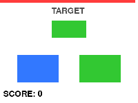 |
| 🟦 **Intermediate**| 14 | [Maze Runner](./14-迷宫逃脱/) | 5 Lessons | 10x10 maze model, 4-corner bounding box anti-tunneling, countdown & reset | 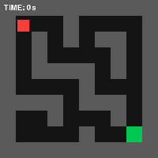 |
| 🟥 **Master** | 15 | [Brick Breaker](./15-打砖块/) | 5 Lessons | Ball reflection, mouse paddle control, 4x5 brick grid, elimination & victory | 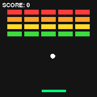 |
| 🟥 **Master** | 16 | [Space Invaders](./16-太空射击/) | 5 Lessons | Vector triangle ship, laser bullet firing, many-to-many Euclidean collisions | 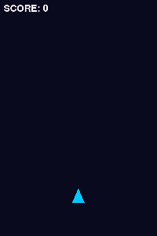 |
| 🟥 **Master** | 17 | [Simon Memory](./17-颜色记忆大师/) | 5 Lessons | 4-color quadrant canvas, finite state machine, progressive sequence validation | 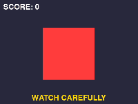 |
| 🟥 **Master** | 18 | [Gold Miner](./18-黄金矿工/) | 5 Lessons | Sinusoidal polar pendulum swing, spacebar claw launch, weight retraction speed | 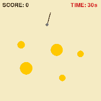 |

---

## 🚀 Quick Start

### 1. Prerequisites & Environment Setup
Make sure you have **Python 3.10 ~ 3.13 (Python 3.12 recommended)** installed on your system.
> ⚠️ **Note for Beginners**: Python 3.14 is a stable release, but Pygame (2.6.1) does not ship pre-built wheels for 3.14 yet, so `pip install pygame` fails there. On **Python 3.14+**, install the compatible community edition **pygame-ce** instead — no code changes are needed:
>
> ```bash
> pip install pygame-ce
> ```
>
> CI runs every lesson on Python 3.10 / 3.12 / 3.13 (pygame) and Python 3.14 (pygame-ce).

Open your terminal and run the following command to install **Pygame**:

```bash
pip install -r requirements.txt
```

### 2. Interactive Graphical Launcher (Recommended)
To preview and launch lessons effortlessly, we have built a **Pygame GUI Launcher**. Run it from the repository root:

```bash
python run_launcher.py
```

Features:
* **Dark Mode Aesthetics**: Smooth mouse hover highlights, neon borders, and selected item states.
* **Dual-Column Layout**: 18 games listed on the left; lessons for the selected game displayed as cards on the right.
* **Direct Links**: Author website link at the bottom-left automatically opens your browser.

---

## 🛠️ Contributing

Contributions are welcome! Please read [CONTRIBUTING.md](./CONTRIBUTING.md) to ensure any new lessons align with the project's standards (pure Chinese variable names, column-aligned comments, vector drawing, default fonts).

---

## 📄 License

This project is licensed under the **[MIT License](./LICENSE)**.

---

## 👨‍💻 Author

* **Author**: 程小宝 (Cheng Xiaobao)
* **Official Website**: [xbkjz.cn](http://xbkjz.cn)
* **GitHub Profile**: [@HenryYannis](https://github.com/HenryYannis)
